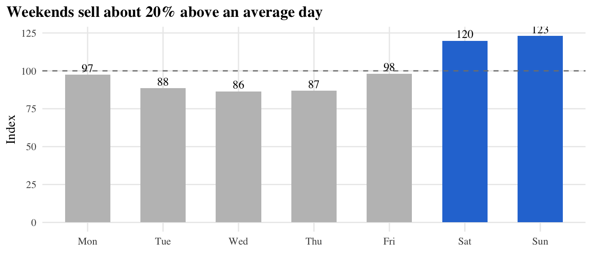
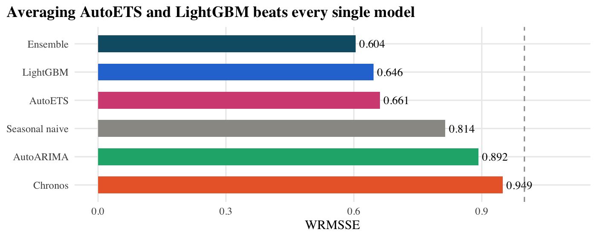
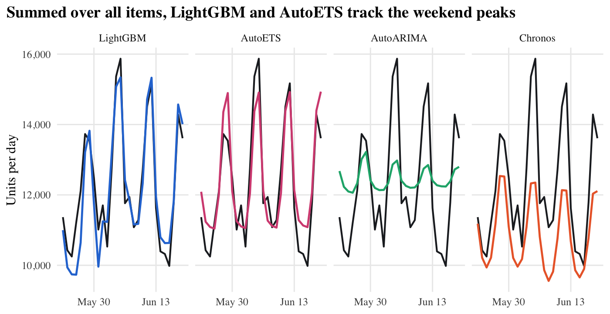
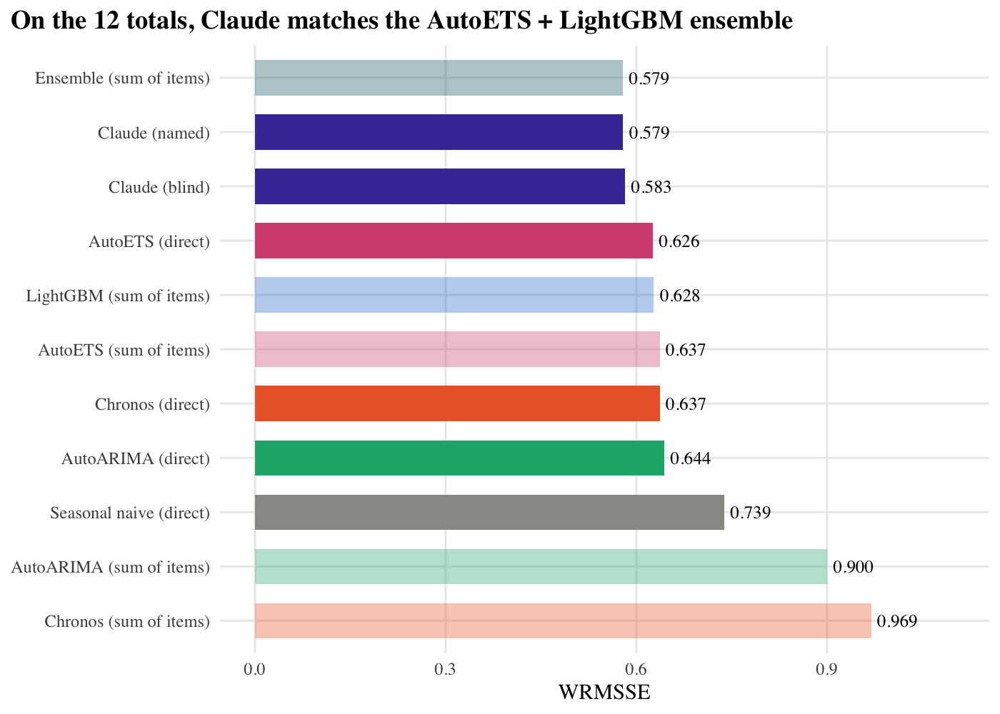
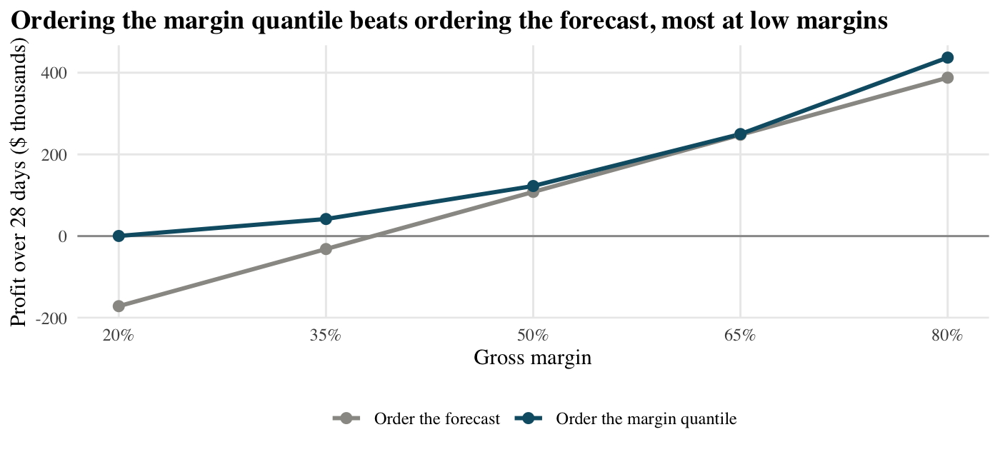

# Can AI Foundation Models Beat Traditional Statistical Models?

**Forecasting daily demand for 5,748 Walmart food items**

**Group 3:** Charlotte Zhu, Shihan Wang, Jing Chang, Rachel Liu
UCLA Anderson, Time Series Analysis and Forecasting (Dr. William Yu), fall 2026

| Final report | Slide deck | Live dashboard | Code |
|---|---|---|---|
| [PDF](report/report.pdf) · [source](report/report.qmd) | [PowerPoint](presentation/Group3_Forecasting_Presentation.pptx) · [PDF](presentation/Group3_Forecasting_Presentation.pdf) | [Shelf Signal v2](https://shihan-2002.github.io/shelf-signal-dashboard/#planner) | [`src/`](src/) (Python) · [`report/`](report/) (R) |

## 1. Why this question

Retail forecasting has to balance **accuracy, efficiency and business value**.

- **Today's default:** LightGBM, a machine-learning method, dominates this kind of retail data and has become the industry default.
- **The challenger:** AI foundation models, pre-trained on huge datasets, can forecast a product they have never seen, with no training at all.

So we ask:

1. **Can pre-trained AI forecast as well as traditional methods, at a practical cost?**
2. **Does a better forecast mean a better replenishment decision?**

## 2. Data: 5,748 daily series, one 28-day test window

- **Scope:** Walmart's [M5 data](https://www.kaggle.com/competitions/m5-forecasting-accuracy): all 1,437 food items in 4 California stores = 5,748 item × store series, with prices, holidays and SNAP (food-stamp) days.
- **Training:** Jan 29, 2011 – May 22, 2016 (1,941 days). Every model is fitted and tuned here.
- **Test:** May 23 – Jun 19, 2016 (28 days, the official M5 window), never seen by any model.
- **Metric:** WRMSSE, the official M5 score: each series' error relative to a naive forecast, weighted by dollar sales. Lower is better; below 1 beats naive.

The data is hard: weekends sell about 20% above an average day, and the typical item sells nothing on half of all days.



## 3. Five models plus a simple average

| Model | Family | How it forecasts | What it sees |
|---|---|---|---|
| AutoETS | Statistics | One exponential smoothing model per series | Own history |
| AutoARIMA | Statistics | One seasonal ARIMA model per series | Own history |
| LightGBM | Machine learning | One model trained across all items, predicts each item | History + price, calendar, SNAP |
| Chronos-Bolt (small) | AI foundation model (Amazon) | Pre-trained, zero-shot: no training on our data; M5 held out of its training | Own history |
| Ensemble | Combination | Unweighted average of AutoETS and LightGBM | Their two forecasts |
| Seasonal naive | Benchmark | Same weekday last week | Last week |
| Claude Opus 5.5 (experiment) | General-purpose AI | Reads sales as text and reasons; 112 series only | History + price, calendar |

## 4. Traditional models win on accuracy

| Model | Overall accuracy (WRMSSE) | Store totals (daily error) | Single items (RMSSE) | Time for all series | Training needed |
|---|---|---|---|---|---|
| **Ensemble (AutoETS + LightGBM)** | **0.604** | **3.6%** | **0.90** | ~3 min | Yes |
| LightGBM | 0.646 | 4.1% | 0.92 | 80 s | Yes |
| AutoETS | 0.661 | 4.9% | 0.93 | 86 s | Yes |
| AutoARIMA | 0.892 | 9.9% | 0.94 | 39 min | Yes |
| Chronos (AI) | 0.949 | 10.4% | 0.92 | **10 s** | **None** |
| Seasonal naive (benchmark) | 0.814 | 5.5% | 1.17 | <1 s | None |

Smaller is better in every accuracy column. "Time for all series" is how long each model takes to produce the whole forecast for all 5,748 series, training included, on one laptop.



## 5. Traditional tracks the peaks; the AI runs low



- **LightGBM and AutoETS** follow every weekend peak. Their errors partly cancel (LightGBM runs about 1% low, AutoETS about 1% high), which is why their average is best.
- **AutoARIMA** forecasts a near-flat line for slow-selling items, and thousands of flat lines add up to a flat total.
- **Chronos** follows each item's weekly rhythm, so its shape is right, but it forecasts about 11% low. The shortfall is concentrated in sparse items (−49% for the sparsest quarter vs −4% for the busiest), where its quantile-based forecast misses the rare busy days.

## 6. Claude: a language model that reads sales as text

Claude received each series' last year of daily sales as text and returned 28 daily forecasts in a fixed JSON format. To keep cost down it forecast a subset: 100 random items plus the 12 store × department totals (4 stores × 3 food departments). Every other model was scored on the same series, and the totals were also fitted directly for the other models.



- On the **12 totals**, Claude (0.579) matched the best traditional approach, the ensemble (0.579), and beat every single model.
- On the **100 items**, it was in the pack behind AutoETS (0.938) and AutoARIMA (0.951).
- **How totals are built matters:** fitted directly on the totals instead of summing item forecasts, AutoARIMA improves from 0.900 to 0.644 and Chronos from 0.969 to 0.637.

| | Chronos | Claude |
|---|---|---|
| Trained on | Time series | Text |
| Reads our data as | Numbers | Rows of text |
| Returns | Quantiles | Forecast + explanation |
| All 5,748 series | 10 s, free | Hours; paid per request |

## 7. Using an LLM to forecast: risks and safeguards

| Risk | What we did |
|---|---|
| Pre-training contamination: M5 is public | Named vs blind test: names, dates and year removed. Accuracy unchanged (0.579 vs 0.583) |
| Unstable output | Fixed prompt and model; every response saved in [`outputs/claude_raw/`](outputs/claude_raw/) |
| Cost and scale | Tested a subset (100 items + 12 totals); same subset for every model |
| Malformed answers | Required a fixed JSON format, checked 28 days returned, retried on failure |

The blind test works like a permutation test: if the labels carry no information, removing them should not change the result, and it did not. It cannot guarantee contamination is excluded, though: the sales pattern itself could still be recognised.

## 8. Our answer: use a traditional ensemble

- **Traditional methods lead on accuracy:** LightGBM, AutoETS and their average are the three best.
- **AI shows no clear accuracy advantage:** Chronos trails the seasonal-naive benchmark overall, and Claude only matched the ensemble on the 12 totals, tested on 112 series only.
- **AI lacks interpretability:** Chronos is a black box, and Claude's written reasoning cannot be verified and its forecasts are not exactly reproducible, whereas AutoETS's level, trend and season and LightGBM's inputs can be inspected.
- **Recommendation:** average AutoETS and LightGBM.

### Business insight: the best order is not the forecast

Ordering stock is a newsvendor problem. Running out loses the margin (underage cost); unsold food wastes its cost (overage cost). The profit-maximising order is the demand quantile equal to the margin:

$$Q^* = F^{-1}\left(\frac{c_u}{c_u + c_o}\right) = F^{-1}(\text{margin})$$

We turned the ensemble's forecasts into daily orders for every item and scored them against actual sales. The ensemble gives a single number, not a distribution, so to read off a quantile we assume demand follows a negative binomial distribution centred on its forecast (Chronos uses its own quantiles):



**How you order matters far more than which model you use.** At a 20% margin, ordering the forecast loses $172k over 28 days, while ordering the margin quantile breaks even. Across models, profit under the quantile rule never differs by more than $20k.

### Limitations

- One 28-day test window: close rankings could flip in another month.
- Claude: 112 series only; the blind test can't fully rule out contamination.
- Sales are not demand: an empty shelf records zero sales.
- Our accuracy metrics weigh over- and under-forecasting equally, but the business cost does not.

## 9. Demo: Shelf Signal dashboard

**[Open the live dashboard](https://shihan-2002.github.io/shelf-signal-dashboard/#planner)**: Shelf Signal v2 brings every model in this project into one interactive page. It builds on our teammate Jing Chang's original [Shelf Signal](https://jing0712.github.io/shelf-signal/) ([code](https://github.com/Jing0712/shelf-signal)), which first studied store CA_1 with 15 items. Source: [`shelf-signal-dashboard`](https://github.com/shihan-2002/shelf-signal-dashboard) (the page, plus the `worker/` behind the live analyst).

- **Forecast explorer:** pick any total, store, department or item and compare every model against actual sales.
- **AI lab:** Claude's own reasoning for each series, and the named-vs-blind test.
- **Order planner:** change the margin and watch the order move between P20 and P80, with profit scored for every model.
- **Ask the analyst:** type your own question for a live answer from Claude Sonnet 5.5, or pick one of five sample questions.

## How to reproduce

```bash
python3 -m venv .venv && .venv/bin/pip install -r requirements.txt
mkdir -p data/raw && curl -L -o data/raw/m5.zip https://github.com/Nixtla/m5-forecasts/raw/main/datasets/m5.zip
unzip data/raw/m5.zip -d data/raw     # raw data is not in the repo (about 450 MB)
cd src
../.venv/bin/python prep.py                       # build data/processed (about 1 min)
../.venv/bin/python models_stat.py                # AutoETS, AutoARIMA, seasonal naive (about 40-50 min on 10 cores)
../.venv/bin/python models_lgb.py                 # LightGBM (about 1-2 min)
../.venv/bin/python models_chronos.py             # Chronos-Bolt (downloads about 200 MB of weights the first time)
../.venv/bin/python models_ensemble.py            # AutoETS + LightGBM average
../.venv/bin/python evaluate.py                   # accuracy and profit tables -> outputs/results/
../.venv/bin/python models_direct_agg.py          # models fitted directly on the 12 totals
../.venv/bin/python models_claude.py              # Claude forecasts (needs an API key; about $14)
../.venv/bin/python evaluate_claude.py            # Claude comparison -> outputs/results/claude_accuracy.csv
../.venv/bin/python export_report_data.py         # CSVs for the report -> outputs/results/report/
../.venv/bin/python export_chronos_diagnostics.py # Chronos bias by volume and quantile calibration
../.venv/bin/python export_dashboard.py           # dashboard -> docs/index.html
cd ../report && quarto render report.qmd          # report.html and report.pdf (needs R + tidyverse)
```

- Claude needs an Anthropic API key in a git-ignored `.env` file at the project root (`ANTHROPIC_API_KEY="..."`). Saved responses are in `outputs/claude_raw/`, so you can skip `models_claude.py` and still run `evaluate_claude.py`.
- The figures in this README come from `report/report.qmd` and are saved in `figures/`.
- The dashboard is one self-contained page: open `docs/index.html` in any browser. Its template is `dashboard/template.html`.

## Project layout

```
src/                 pipeline scripts (prep, models_*, evaluate*, export_*)
outputs/forecasts/   one parquet file per model family
outputs/claude_raw/  every Claude response (JSON)
outputs/results/     accuracy, profit, Claude comparison and timing tables; report/ holds the report's CSVs
report/              final report (Quarto, R)
presentation/        slide deck (pptx and PDF)
dashboard/, docs/    dashboard template and built page
figures/             charts used in this README
data/                M5 data (not committed)
```

## Use of AI tools

Chronos and Claude are forecasting models under test. We also used Claude Code to write the pipeline, evaluation code, charts, dashboard and slides, and to draft the report. We reviewed and corrected its output, and every number in the report is read from the pipeline's output files.
