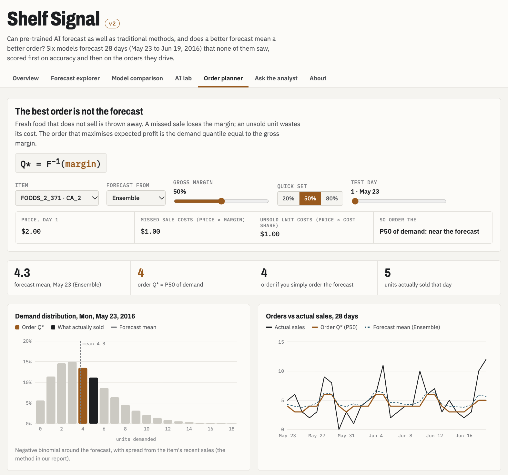

```{r setup}
library(tidyverse)
library(scales)
library(knitr)

dir <- "../outputs/results/report"
rd <- function(f) read_csv(file.path(dir, f), show_col_types = FALSE)

acc       <- rd("accuracy.csv") |> rename(model = 1)
by_level  <- rd("accuracy_by_level.csv") |> rename(level = 1)
claude    <- rd("claude_accuracy.csv")
timing    <- rd("timing.csv")
weekly    <- rd("weekly_sales.csv")
weekday   <- rd("weekday_index.csv")
facts     <- rd("data_facts.csv")
test_tot  <- rd("test_window_totals.csv")
best      <- rd("item_best_share.csv")
by_zero   <- rd("item_rmsse_by_zero_share.csv")
nv_boot   <- rd("newsvendor_bootstrap.csv")
nv_pred   <- rd("newsvendor_predicted_vs_actual.csv")
tm_metrics <- rd("teammate_metrics_summary.csv")
tm_event   <- rd("teammate_holiday_error.csv")
tm_inv     <- rd("teammate_inventory_backtest.csv")
ch_vol     <- rd("chronos_bias_by_volume.csv")
ch_cal     <- rd("chronos_calibration.csv")

# One fixed colour per model, the same in every chart
pal <- c(AutoARIMA = "#1BAF7A", AutoETS = "#D55181", LightGBM = "#2A78D6", Chronos = "#EB6834", Ensemble = "#0F5C73",
         Claude = "#4A3AA7", `Seasonal naive` = "#9A9993", Actual = "#1F2328")
main_models <- c("AutoETS", "AutoARIMA", "LightGBM", "Chronos")
lab <- c(SeasonalNaive = "Seasonal naive", AutoARIMA = "AutoARIMA", AutoETS = "AutoETS",
         LightGBM = "LightGBM", Ensemble = "Ensemble", Chronos = "Chronos")
theme_set(theme_minimal(base_size = 11, base_family = "Times") +
            theme(panel.grid.minor = element_blank(), plot.title = element_text(face = "bold"),
                  plot.title.position = "plot", legend.position = "bottom"))

w <- function(m) acc$WRMSSE[acc$model == m]
f3 <- function(x) sprintf("%.3f", x)
pct <- function(x, d = 0) percent(x, accuracy = 10^-d)
mape <- function(m) mean(abs(test_tot[[m]] - test_tot$y) / test_tot$y)
bias <- function(m) sum(test_tot[[m]]) / sum(test_tot$y) - 1
cov <- function(q) pct(ch_cal$coverage[abs(ch_cal$quantile - q) < 1e-9])
cl <- function(m, lvl) claude$WRMSSE[claude$model == m & claude$level == lvl]
secs <- function(m) timing$wall_seconds[timing$model == m]
fmt_time <- function(s) if (s < 120) paste(round(s), "s") else paste(round(s / 60), "min")
share <- function(m) pct(best$share[best$model == m])
claude_n <- timing$series[timing$model == "Claude"]
claude_cost <- timing$api_cost_usd[timing$model == "Claude"]
claude_full_s <- secs("Claude") / claude_n * 5748
claude_full_cost <- claude_cost / claude_n * 5748
# Best non-Claude model on the 12 totals
tot_rank <- claude |> filter(level == "store x dept", !str_detect(model, "Claude")) |> arrange(WRMSSE)
item_rank <- claude |> filter(level == "item x store") |> arrange(WRMSSE)
```

::: {.content-visible when-format="html"}
*Time Series Analysis and Forecasting, UCLA Anderson (Dr. William Yu). Final project report, Group 3.*
:::

# Executive summary

**Question.** Can modern AI foundation models produce more accurate and computationally efficient retail demand forecasts than traditional statistical and machine-learning methods?

**What we did.** We forecast 28 days of daily unit sales for all 1,437 food items in Walmart's four California stores (`r comma(facts$n_series)` item-store series, M5 data). Four main models were compared against a seasonal-naive benchmark: two classical time series models (**AutoETS** and **AutoARIMA**), the machine-learning method that dominated the M5 competition (**LightGBM**), and an AI foundation model for time series (Amazon's **Chronos**). We also tested a simple **ensemble**, the unweighted average of AutoETS and LightGBM. As an experiment, a general-purpose large language model (**Claude**) forecast a subset of series. No model saw the 28 test days while fitting.

**What we found.**

- **LightGBM is the most accurate single model across all series** (WRMSSE `r f3(w("LightGBM"))`), with **AutoETS close behind** (`r f3(w("AutoETS"))`). AutoARIMA (`r f3(w("AutoARIMA"))`) and Chronos (`r f3(w("Chronos"))`) trail the seasonal-naive benchmark (`r f3(w("SeasonalNaive"))`).
- **Averaging the two best is better still.** The AutoETS + LightGBM ensemble scores `r f3(w("Ensemble"))`, the best of all models and best at every aggregation level, with no tuning.
- **The ranking depends on the level.** LightGBM's lead is at store and department levels; for a single item in one store the models are close, with no model best on more than `r pct(max(best$share))` of items. Close is not the same as statistically tied: we did not test these item-level gaps formally.
- **Chronos's advantage is speed, not accuracy here.** It needs no training and forecasts every series in `r fmt_time(secs("Chronos"))`, against `r fmt_time(secs("LightGBM"))` for LightGBM, `r fmt_time(secs("AutoETS"))` for AutoETS and `r fmt_time(secs("AutoARIMA"))` for AutoARIMA.
- **Claude matched, but did not beat, the best traditional approach.** On the 12 store × department totals it scored `r f3(cl("Claude (named)", "store x dept"))` (named) and `r f3(cl("Claude (blind)", "store x dept"))` (blind), level with the ensemble (`r f3(cl("Ensemble (sum of items)", "store x dept"))`) and ahead of every single model; on 100 sampled items it trailed AutoETS (`r f3(cl("Claude (blind)", "item x store"))` vs `r f3(item_rank$WRMSSE[1])`). Hiding names and dates did not change its accuracy, but this cannot fully rule out that it has seen the public data.
- **Business insight.** The best order quantity is not the forecast: it is a quantile of the demand distribution set by the item's margin (the newsvendor problem). In an exploratory test, the more accurate model earned significantly more only at high margins, so models should be chosen on the decision they support, not on accuracy alone.

**Answer: not yet on accuracy, yes on speed.** Traditional methods still lead on accuracy: LightGBM is the best single model, AutoETS is close, and their simple average is best overall. Chronos offers a large speed advantage; Claude matches the best traditional approach on totals but with too little evidence to recommend; and replenishment decisions depend on costs and uncertainty, not on forecast accuracy alone.

# Purpose and motivation

Retail forecasting has to balance three things: accuracy, efficiency, and business value. LightGBM, a gradient-boosted decision-tree model, dominated the M5 forecasting competition, which asked teams to forecast daily Walmart sales for thousands of products; the organisers' analysis places it at the core of the leading entries [@makridakis2022]. It became the default for retail demand forecasting.

Since then, two kinds of AI model have appeared that forecast without being trained on a retailer's data. **Time series foundation models**, such as Amazon's Chronos [@ansari2024], are pre-trained on millions of series and forecast new ones "zero-shot". **General-purpose large language models**, such as Claude, can read a sales history as text and reason their way to a forecast. If either can match LightGBM, a retailer could skip model training entirely.

We ask: **can modern AI foundation models produce more accurate and computationally efficient retail demand forecasts than traditional statistical and machine-learning methods?** Because a forecast is only useful through the decisions it drives, we close with a business insight on ordering (the newsvendor problem) and what it means for choosing a model.

# Data

We use the M5 data [@kaggle_m5] for the food category of Walmart's four California stores: `r comma(facts$n_series)` daily item-store series, with weekly prices, holidays and events, and SNAP (food-stamp) payment days.

| | |
|---|---|
| Stores and items | CA_1 to CA_4; 1,437 food items in 3 departments |
| Unit of forecasting | One item in one store (item × store), 5,748 series |
| Training period | 2011-01-29 to 2016-05-22 (1,941 days) |
| Test period | 2016-05-23 to 2016-06-19 (28 days, the official M5 evaluation window) |
| Extra inputs | Prices, holidays and events, SNAP days |

```{r fig-weekly}
#| fig-cap: "Weekly food units sold in the four California stores. The dip each December is the Christmas store closure."
ggplot(weekly, aes(week, units)) +
  geom_line(colour = "#1B2A41", linewidth = 0.5) +
  scale_y_continuous(labels = comma, limits = c(0, NA)) +
  labs(title = "Food sales grew about 60% from 2011 to 2016", x = NULL, y = "Units per week")
```

Three features make the data hard to forecast. Weekends sell about 20% above an average day (@fig-weekday). Sales are `r pct(facts$snap_lift)` higher on SNAP days. And demand is sparse: the median item sold nothing on `r pct(facts$median_zero_share)` of days in the last year.

```{r fig-weekday}
#| fig-cap: "Average daily sales by weekday, indexed to the average day (= 100)."
#| fig-height: 3
weekday |>
  mutate(weekday = factor(substr(weekday, 1, 3), levels = substr(weekday, 1, 3)),
         weekend = weekday %in% c("Sat", "Sun")) |>
  ggplot(aes(weekday, index, fill = weekend)) +
  geom_col(width = 0.6) +
  geom_hline(yintercept = 100, linetype = "dashed", colour = "grey50") +
  geom_text(aes(label = round(index)), vjust = -0.4, size = 3.5, family = "Times") +
  scale_fill_manual(values = c(`TRUE` = "#2A78D6", `FALSE` = "grey75"), guide = "none") +
  labs(title = "Weekends sell about 20% above an average day", x = NULL, y = "Index")
```

# Methodology and validation

## Models

| Model | Family | Trained on our data? | Inputs | How it forecasts |
|---|---|---|---|---|
| AutoETS | Classical statistics | Yes, one model per series | Last 730 days of that series | Exponential smoothing with a 7-day season; error, trend and season form chosen automatically by AIC |
| AutoARIMA | Classical statistics | Yes, one model per series | Last 730 days of that series | Seasonal ARIMA with a 7-day cycle; orders chosen automatically by AIC |
| LightGBM | Machine learning | Yes, one global model | All series, plus price, weekday, month, holidays, SNAP | Gradient-boosted trees on sales lags of 28+ days and rolling means; Tweedie loss |
| Chronos-Bolt (small) | AI foundation model for time series | No (zero-shot) | Last 512 days of that series | Transformer pre-trained on about 100 billion observations; outputs quantiles |
| Ensemble | Combination | No extra fitting | AutoETS and LightGBM forecasts | Unweighted average of AutoETS and LightGBM |
| Seasonal naive | Benchmark | No | Last week | Repeats the same weekday from last week |
| Claude Opus 5.5 (experiment) | General-purpose large language model | No (zero-shot) | Last 365 days as text, with weekday, holiday, SNAP, price | Reads the numbers and reasons about them; no statistical model is fitted |

**Why these models.** Each one stands for an approach a retailer could realistically use. AutoETS and AutoARIMA are the classical models covered in the course, fitted automatically so that no series needs hand-tuning. LightGBM is the machine-learning method that dominated the M5 competition, so it is the benchmark an AI model has to beat. Chronos-Bolt is a widely used, open time series foundation model that runs on a laptop; we chose the small version for speed. Claude represents general-purpose LLMs, the "ask ChatGPT or Claude" route. The ensemble tests the classic finding that combining a statistical and a machine-learning forecast helps, and seasonal naive is the floor every model must clear.

**What information each model had.** The models do not see the same inputs: AutoETS, AutoARIMA and Chronos use only the series' own history, while LightGBM and Claude also see prices and the calendar. None of them sees the test window. The Chronos paper keeps M5, and every retail dataset it uses, out of training as held-out test sets, so Chronos never trained on this data [@ansari2024].

**How the AI forecasts were produced.** *Chronos* reads the last 512 days of each series and returns nine quantiles (10th to 90th percentile) for each of the next 28 days; nothing is fitted. Its built-in point forecast is the median, which sits below the mean for sparse, right-skewed sales, so we use the average of the nine quantiles as its point forecast. *Claude* receives each series as text, one row per day, with an instruction to return 28 daily forecasts in a fixed JSON format with a short explanation; the code checks every reply and retries on a malformed one (details in @sec-claude).

## Validation design

- **Out-of-sample test.** Every model is trained on data up to 2016-05-22 and forecasts the same 28 days. LightGBM's number of trees was tuned by early stopping on the last 28 *training* days, so the test window was never used for fitting or tuning.
- **Level of forecasting.** All main models forecast each of the 5,748 item × store series. Store, department and total forecasts are the sums of those item forecasts (bottom-up).
- **Accuracy metric.** The main metric is **WRMSSE**, the official M5 score: each series' root mean squared error is scaled by its in-sample naive one-step error and weighted by its dollar sales in the last 28 training days. Values below 1 beat a naive forecast. WRMSSE is averaged over six levels (total, store, department, store × department, item, item × store). We also report MAE, RMSE, the daily error (MAPE) of summed totals, and bias.
- **Claude subset.** Claude is called once per series through an API, so forecasting all 5,748 series would cost about \$`r round(claude_full_cost)` and take hours. It therefore forecast a subset of 112 series: 100 items sampled at random (fixed seed) from items with sales in the last 90 days, and the 12 store × department totals (4 stores × 3 food departments, FOODS_1 to FOODS_3; each total is the daily sum of every item in that department and store). Every other model is scored on exactly the same subset.
- **Direct vs summed totals.** Claude forecasts each total directly. For a fair comparison, AutoETS, AutoARIMA, Chronos and seasonal naive were also fitted directly on the 12 totals. LightGBM needs many series to train, so its totals remain sums of item forecasts.
- **Memorisation check.** Each Claude forecast was run twice: *named* (real dates, Walmart, item and store IDs, holiday names) and *blind* (no names or dates, only "day −364 … +28", weekday and a generic holiday flag).
- **Efficiency.** Each model was timed from prepared data to finished forecasts for all 5,748 series, including any training, one model at a time on the same laptop (10 CPU cores, Apple GPU). Data preparation and scoring, which are the same for every model, are excluded.
- **One test window.** All results come from a single 28-day window; see the limitations.

# Results

## Overall accuracy: LightGBM leads the single models; the ensemble is best

```{r tbl-acc}
#| tbl-cap: "Accuracy on all 5,748 series over the 28-day test window, sorted by WRMSSE."
acc |>
  filter(model %in% names(lab)) |>
  arrange(WRMSSE) |>
  transmute(Model = lab[model], WRMSSE = f3(WRMSSE), `MAE (units)` = f3(MAE), `RMSE (units)` = f3(RMSE),
            `Daily error of total` = map_chr(model, ~ pct(mape(.x), 1))) |>
  kable(align = "lrrrr")
```

```{r fig-wrmsse}
#| fig-cap: "WRMSSE on all 5,748 series (lower is better). The dashed line at 1 is a naive one-step forecast."
#| fig-height: 2.8
acc |>
  filter(model %in% names(lab)) |>
  mutate(model = fct_reorder(lab[model], -WRMSSE)) |>
  ggplot(aes(WRMSSE, model, fill = model)) +
  geom_col(width = 0.6) +
  geom_text(aes(label = f3(WRMSSE)), hjust = -0.15, size = 3.4, family = "Times") +
  geom_vline(xintercept = 1, linetype = "dashed", colour = "grey60") +
  scale_fill_manual(values = pal, guide = "none") +
  scale_x_continuous(limits = c(0, 1.1)) +
  labs(title = "Averaging AutoETS and LightGBM beats every single model", x = "WRMSSE", y = NULL)
```

Among single models, LightGBM has the lowest WRMSSE and RMSE, with AutoETS close behind; both beat the benchmark. Their unweighted average is better than either (`r f3(w("Ensemble"))`), echoing the M5 finding that combinations of forecasts are hard to beat [@makridakis2022]. The two models make different kinds of errors, so averaging cancels part of them: summed over all items, LightGBM runs `r pct(abs(bias("LightGBM")), 1)` low and AutoETS `r pct(bias("AutoETS"), 1)` high over the test window, and their average is within `r pct(abs(bias("Ensemble")), 1)` of actual sales. Chronos has the lowest MAE of the single models but the weakest WRMSSE: MAE rewards getting the typical day right, while WRMSSE punishes errors that add up across items.

```{r fig-test}
#| fig-cap: "Total daily units across all items in the test window: actual (black) against each model's summed item forecasts."
#| fig-height: 3.6
test_tot |>
  pivot_longer(all_of(main_models), names_to = "model", values_to = "forecast") |>
  mutate(model = factor(model, levels = c("LightGBM", "AutoETS", "AutoARIMA", "Chronos"))) |>
  ggplot(aes(ds)) +
  geom_line(aes(y = y), colour = "#1F2328", linewidth = 0.7) +
  geom_line(aes(y = forecast, colour = model), linewidth = 0.8) +
  facet_wrap(~model, nrow = 1) +
  scale_colour_manual(values = pal, guide = "none") +
  scale_y_continuous(labels = comma) +
  scale_x_date(date_labels = "%b %d", date_breaks = "2 weeks") +
  labs(title = "Summed over all items, LightGBM and AutoETS track the weekend peaks",
       x = NULL, y = "Units per day")
```

## Rankings change with the aggregation level

```{r fig-level}
#| fig-cap: "RMSSE by aggregation level (lower is better). Item-level forecasts are summed up to each level."
lv <- c("L1 total" = "Total", "L2 store" = "Store", "L3 dept" = "Dept",
        "L4 store x dept" = "Store x dept", "L5 item" = "Item", "L6 item x store" = "Item x store")
by_level |>
  select(level, all_of(names(lab))) |>
  pivot_longer(-level, names_to = "model", values_to = "rmsse") |>
  mutate(level = factor(lv[level], levels = lv), model = lab[model]) |>
  ggplot(aes(level, rmsse, colour = model, group = model, linetype = model == "Seasonal naive")) +
  geom_hline(yintercept = 1, colour = "grey60", linetype = "dotted") +
  geom_line(linewidth = 1) + geom_point(size = 2) +
  scale_colour_manual(values = pal) +
  scale_linetype_manual(values = c(`FALSE` = "solid", `TRUE` = "dashed"), guide = "none") +
  labs(title = "The models differ most at aggregate levels and converge at item level",
       x = NULL, y = "RMSSE", colour = NULL)
```

The models differ most at the levels retailers plan with: store, department and total. Summed to the four-store total, the daily error is `r pct(mape("LightGBM"), 1)` for LightGBM and `r pct(mape("AutoETS"), 1)` for AutoETS, against `r pct(mape("AutoARIMA"), 1)` for AutoARIMA and `r pct(mape("Chronos"), 1)` for Chronos (@fig-test). The two weaker models fail in different ways. AutoARIMA produces nearly flat forecasts for items selling 0–2 units a day, and thousands of flat lines add up to a total that misses the weekly peaks. Chronos does follow each item's weekly pattern, so its total has the right shape, but it runs `r pct(abs(bias("Chronos")))` low. The shortfall is not a trend effect: it grows with sparsity (@tbl-chronos-vol). For an item that sells nothing on most days, the lower quantiles are near zero and the rare busy days lie above the 90th percentile, so the average of the nine quantiles misses them.

```{r tbl-chronos-vol}
#| tbl-cap: "Chronos's total forecast against actual sales over the test window, with items split into quarters by their sales in the last 56 training days."
ch_vol |>
  transmute(`Items` = group, `Actual units` = comma(y), `Chronos forecast` = comma(round(Chronos)),
            `Chronos vs actual` = pct(gap)) |>
  kable(align = "lrrr")
```

```{r fig-item}
#| fig-cap: "Mean RMSSE per item-store series, grouped by how often the item sells zero."
by_zero |>
  pivot_longer(all_of(names(lab)), names_to = "model", values_to = "rmsse") |>
  mutate(model = factor(lab[model], levels = c("AutoETS", "AutoARIMA", "LightGBM", "Ensemble", "Chronos", "Seasonal naive")),
         zero_days = factor(paste0(zero_days, "\n(", comma(n_series), " series)"),
                            levels = unique(paste0(zero_days, "\n(", comma(n_series), " series)")))) |>
  ggplot(aes(zero_days, rmsse, fill = model)) +
  geom_col(position = position_dodge(width = 0.85), width = 0.8) +
  scale_fill_manual(values = pal) +
  labs(title = "At item level, the four main models are close and all beat the benchmark",
       x = "Share of days with zero sales", y = "Mean RMSSE", fill = NULL)
```

For one item in one store, the models are close: among the four single models, each is the most accurate on part of the items (LightGBM `r share("LightGBM")`, Chronos `r share("Chronos")`, AutoETS `r share("AutoETS")`, AutoARIMA `r share("AutoARIMA")`), and all beat the benchmark by a similar margin. Daily sales of a single item are mostly noise. "Close" here is descriptive; we did not run a formal test of equal accuracy.

## Claude: a general-purpose LLM as a forecaster {#sec-claude}

Claude received each series' last 365 days as text (date, weekday, holiday, SNAP day, price, units) and returned 28 daily forecasts in a fixed JSON format, together with a short explanation of its reasoning. It cost \$`r sprintf("%.2f", claude_cost)` for `r claude_n` forecasts.

```{r fig-claude}
#| fig-cap: "WRMSSE on the 12 store × department totals. Pale bars are totals built by summing item forecasts; solid bars are fitted directly on each total."
claude |>
  filter(level == "store x dept", model != "SeasonalNaive (sum of items)") |>
  mutate(family = str_remove(model, " \\(.*") |> recode(SeasonalNaive = "Seasonal naive"),
         summed = str_detect(model, "sum of items"),
         model = str_replace(model, "SeasonalNaive", "Seasonal naive") |> fct_reorder(-WRMSSE)) |>
  ggplot(aes(WRMSSE, model, fill = family, alpha = summed)) +
  geom_col(width = 0.65) +
  geom_text(aes(label = f3(WRMSSE)), hjust = -0.15, size = 3.2, alpha = 1, family = "Times") +
  scale_fill_manual(values = pal, guide = "none") +
  scale_alpha_manual(values = c(`FALSE` = 1, `TRUE` = 0.35), guide = "none") +
  scale_x_continuous(limits = c(0, 1.1)) +
  labs(title = "On the 12 totals, Claude matches the AutoETS + LightGBM ensemble", x = "WRMSSE", y = NULL)
```

```{r tbl-claude-items}
#| tbl-cap: "Accuracy on the 100 sampled items (same items for every model)."
item_rank |>
  mutate(model = recode(model, SeasonalNaive = "Seasonal naive")) |>
  transmute(Model = model, WRMSSE = f3(WRMSSE), `MAE (units)` = f3(MAE)) |>
  kable(align = "lrr")
```

On the 12 totals, Claude (`r f3(cl("Claude (named)", "store x dept"))` named, `r f3(cl("Claude (blind)", "store x dept"))` blind) was level with the ensemble (`r f3(cl("Ensemble (sum of items)", "store x dept"))`) and ahead of every single model, the best of which was `r tot_rank$model[2]` (`r f3(tot_rank$WRMSSE[2])`). Fitting the totals directly also matters: AutoARIMA improves from `r f3(cl("AutoARIMA (sum of items)", "store x dept"))` to `r f3(cl("AutoARIMA (direct)", "store x dept"))` and Chronos from `r f3(cl("Chronos (sum of items)", "store x dept"))` to `r f3(cl("Chronos (direct)", "store x dept"))`. On the 100 items, Claude ranked behind `r item_rank$model[1]` and `r item_rank$model[2]`. Named and blind forecasts were equally accurate (`r f3(cl("Claude (named)", "store x dept"))` vs `r f3(cl("Claude (blind)", "store x dept"))` on totals), so real dates and product names gave Claude no advantage.

**How Claude differs from Chronos.** Both are transformer models used zero-shot, but they are different tools:

| | Chronos | Claude |
|---|---|---|
| Trained on | Time series (about 100 billion observations; M5 held out) | Text and code |
| Reads our data as | Numbers (scaled and tokenised) | Text, one row per day |
| Inputs used | Sales history only | Sales history, calendar, price |
| Output | Quantile forecasts | Point forecast, percentiles and a written explanation |
| Speed and cost, all series | `r fmt_time(secs("Chronos"))` on a laptop, free | About `r round(claude_full_s / 3600, 1)` hours and \$`r round(claude_full_cost)` (estimated) |
| Same output on a rerun? | Yes | Not exactly |

**Risks of using an LLM, and how we handled them.**

| Risk | What we did | What remains |
|---|---|---|
| Pre-training contamination: M5 is public and may be in Claude's training data | Named vs blind comparison: blind prompts remove names, dates and the year | The blind test reduces identity cues, but it **cannot guarantee** that contamination is excluded: the sales pattern itself could still be recognised |
| Unstable output: answers can vary between runs | Fixed prompt and model, every response saved | We did not rerun forecasts to measure the variation |
| Cost and scale | Tested a subset (100 items + 12 totals), cached every response | Results on 112 series may not hold for all 5,748 |
| Malformed answers | Required a fixed JSON schema; checked 28 days returned; retried on failure | None observed in 224 calls |

## Computational efficiency

```{r tbl-eff}
#| tbl-cap: "Time to fit and forecast all 5,748 series on the same laptop. Claude is scaled up from its measured run."
tibble(model = c("Chronos", "LightGBM", "AutoETS", "AutoARIMA")) |>
  mutate(`Time, all series` = map_chr(model, ~ fmt_time(secs(.x))),
         Training = c("None", "About 1 min", "Per series", "Per series"),
         `Cost per run` = "Free") |>
  bind_rows(tibble(model = "Ensemble", `Time, all series` = fmt_time(secs("AutoETS") + secs("LightGBM")),
                   Training = "Both models", `Cost per run` = "Free")) |>
  bind_rows(tibble(model = "Claude", `Time, all series` = paste0("~", round(claude_full_s / 3600, 1), " h (est.)"),
                   Training = "None", `Cost per run` = paste0("~$", round(claude_full_cost), " (est.)"))) |>
  rename(Model = model) |>
  kable(align = "llll")
```

Chronos is about `r round(secs("AutoARIMA") / secs("Chronos"))` times faster than AutoARIMA and `r round(secs("LightGBM") / secs("Chronos"))` times faster than LightGBM, with no training. Its strength in this study is speed rather than accuracy. Claude is the opposite: accurate on the totals, but slow and costly at scale.

# Business insight: the best order is not the forecast (the newsvendor problem)

A forecast is only valuable through the decisions it drives. For perishable food, each day the store orders $Q$ units of an item with price $p$ and gross margin $m$. A missed sale loses the margin, $c_u = pm$; an unsold unit wastes its cost, $c_o = p(1-m)$, assuming leftover food has no salvage value. Expected profit is maximised by ordering

$$
Q^{*} = F^{-1}\!\left(\frac{c_u}{c_u + c_o}\right) = F^{-1}(m),
$$

the $m$-th quantile of the demand distribution $F$. A 20%-margin item should be ordered at the 20th percentile of demand (P20), and an 80%-margin item at the 80th percentile (P80). **The optimal order is generally not the point forecast**: it requires a forecast of the whole demand distribution, not just its average.

This is where Chronos's output is useful. Point-forecast models (AutoETS, LightGBM, the ensemble) need an assumed distribution around their forecast to give a P80. Chronos forecasts the quantiles directly, so the order can be read straight off its output for margins between 10% and 90%. Its upper quantiles were well calibrated in the test window: actual sales were at or below its 80th percentile on `r cov(0.8)` of item-days and at or below its 90th on `r cov(0.9)`. The lower quantiles look over-covered (`r cov(0.1)` at the 10th percentile) mainly because many items sold zero and Chronos forecast near zero, which counts as covered. So a model that is weaker on point accuracy can still be useful for ordering, which is why the metric should match the decision.

As an exploratory extension, we turned each model's forecasts into such orders, using a negative binomial distribution around the forecast (Chronos used its own quantiles), and simulated 28 days of profit at margins from 20% to 80%. To check whether profit gaps were real, we resampled the items 2,000 times.

```{r fig-nv}
#| fig-cap: "Profit difference against LightGBM over 28 days, with 95% bootstrap intervals over items. Intervals crossing zero mean no significant difference."
nv_boot |>
  mutate(model = str_remove(comparison, " minus LightGBM"), margin = percent(margin)) |>
  ggplot(aes(margin, diff / 1000, colour = model)) +
  geom_hline(yintercept = 0, colour = "grey50") +
  geom_pointrange(aes(ymin = lo95 / 1000, ymax = hi95 / 1000), position = position_dodge(width = 0.4)) +
  scale_colour_manual(values = pal) +
  labs(title = "Only at high margins does the more accurate LightGBM earn significantly more",
       x = "Gross margin", y = "Profit minus LightGBM ($ thousands)", colour = NULL)
```

1. **More accuracy did not reliably mean more profit.** At typical margins (35–65%), profit differences between models were within chance. Only at an 80% margin, where stock-outs are costly, did LightGBM earn significantly more.
2. **Accuracy is measured where orders are not placed.** LightGBM's accuracy lead is at aggregate levels, but stores order item by item, where the models are close. Models should be chosen on the metric that matches the decision.
3. **Profit expectations should come from backtests.** Both models over-predicted their own profit (at a 50% margin, LightGBM predicted \$`r round(nv_pred$predicted[nv_pred$margin == 0.5 & nv_pred$model == "LightGBM"] / 1000)`k and earned \$`r round(nv_pred$actual[nv_pred$margin == 0.5 & nv_pred$model == "LightGBM"] / 1000)`k), because the simulation treats each forecast as the true average.

# Interactive dashboard: Shelf Signal

We built **Shelf Signal**, an interactive version of this analysis, by extending our teammate's original Shelf Signal dashboard (code at <https://github.com/Jing0712/shelf-signal>) with this project's models and results. It is live at <https://jing0712.github.io/shelf-signal/#planner> (the link opens on the Order planner) and is a single self-contained web page (`docs/index.html` in the project repository) with seven tabs:

| Tab | What it shows | Report section |
|---|---|---|
| Overview | Headline results, weekly and weekday sales patterns | 1, 3 |
| Forecast explorer | Any total, store, department, store × department or item; actual vs every model over the 28 test days, with per-series accuracy | 5.1–5.2 |
| Model comparison | Accuracy, accuracy by level, run time, and which model wins each item | 5.1, 5.4 |
| AI lab | Chronos vs Claude, the named-vs-blind test, and Claude's written reasoning for each series | 5.3 |
| Order planner | Choose an item, a model and a margin; the order moves along the forecast demand distribution, and profit over 28 days is scored for every model | 6 |
| Ask the analyst | Answers to 11 common questions, with numbers drawn from the results | All |
| About | Method, limitations and credits | 9 |

It covers 134 series: every aggregate level, Claude's 100 sampled items, and the 15 store-CA_1 items from the original Shelf Signal. Forecasts are precomputed by our pipeline; only the order quantities are calculated in the browser, and actual sales are used only to score results afterwards.

**How to use it.**

1. Open the link in any browser; nothing needs to be installed. The page also works offline from `docs/index.html`.
2. **Forecast explorer:** choose a level (for example *Store x dept*) and a series, then switch models on and off to compare them with actual sales.
3. **AI lab:** compare Chronos and Claude, see the named-vs-blind scatter, and open *Read Claude's reasoning* for any series.
4. **Order planner:** choose an item, a model and a margin; move the margin slider to see the order move along the demand distribution and how each model's orders would have done over the 28 test days.
5. **Ask the analyst:** click a question for a short answer drawn from the results.

## Evidence from the original Shelf Signal

Shelf Signal studies a smaller, complementary setting: one store (CA_1), 15 high-selling food items plus the category total, and four models (seasonal naive, Holt-Winters ETS, gradient-boosted trees with Poisson loss, and their average), evaluated on a validation window and a final test window. Three of its results strengthen ours.

```{r tbl-tm}
#| tbl-cap: "Shelf Signal: item-level RMSSE (15 items, store CA_1) on the validation window and the final test window. Lower is better."
tm_metrics |>
  filter(level == "items") |>
  select(split, model, RMSSE) |>
  pivot_wider(names_from = split, values_from = RMSSE) |>
  arrange(test) |>
  transmute(Model = model, `Validation RMSSE` = f3(validation), `Test RMSSE` = f3(test)) |>
  kable(align = "lrr")
```

```{r tm-calc}
tmi <- tm_metrics |> filter(level == "items")
tm_r <- function(m, sp) tmi$RMSSE[tmi$model == m & tmi$split == sp]
```

1. **Rankings change between windows.** At item level, gradient-boosted trees beat ETS on the validation window (`r f3(tm_r("GBM", "validation"))` vs `r f3(tm_r("ETS", "validation"))`) but lost to it on the test window (`r f3(tm_r("GBM", "test"))` vs `r f3(tm_r("ETS", "test"))`). This is direct evidence for our main caveat: a single test window can reverse a close ranking.
2. **Averaging a statistical and a machine-learning model helps, in both studies.** Shelf Signal's ETS + GBM average had the lowest item-level test error (`r f3(tm_r("Ensemble", "test"))`), mirroring our AutoETS + LightGBM ensemble result on a different store, item set and model implementation.
3. **Holidays were not the hard part.** Scaled errors on event days (Super Bowl, Easter, Mother's Day and others) were `r pct(1 - max(tm_event$ratio))`–`r pct(1 - min(tm_event$ratio))` *lower* than on normal days for every model.

```{r fig-tm-inv}
#| fig-cap: "Shelf Signal inventory backtest (15 items, store CA_1, 28 days): raising the safety factor z cuts lost sales but raises the stock held. Each point is one model at one z."
tm_inv |>
  group_by(model, z) |>
  summarise(lost = sum(lost_units), on_hand = sum(avg_on_hand), .groups = "drop") |>
  ggplot(aes(on_hand, lost, colour = model)) +
  geom_path(linewidth = 0.8) + geom_point(size = 2) +
  scale_colour_manual(values = c(ETS = "#D55181", GBM = "#2A78D6", Ensemble = "#0F5C73",
                                 `Seasonal Naive` = "#9A9993")) +
  labs(title = "Same reorder rule, different forecasts: fewer lost sales cost more stock",
       x = "Average units on hand (15 items)", y = "Lost units over 28 days", colour = NULL)
```

The inventory backtest complements our newsvendor analysis. With no safety stock ($z = 0$), the forecasts lose very different amounts of demand (from `r min(tm_inv |> filter(z == 0) |> group_by(model) |> summarise(l = sum(lost_units)) |> pull(l))` to `r max(tm_inv |> filter(z == 0) |> group_by(model) |> summarise(l = sum(lost_units)) |> pull(l))` units); with enough safety stock, lost sales disappear for every model and the difference becomes how much stock each needs to hold. As in the newsvendor analysis, the choice of service level or margin moves the decision more than the choice of model. Shelf Signal notes that observed sales stand in for demand, so this is an illustration of the trade-off, not a cost estimate.

{width=100%}

# Conclusions

1. **Traditional methods still lead on accuracy.** LightGBM is the most accurate single model, AutoETS is close behind, and their simple average is the most accurate of all, a result our teammate's Shelf Signal study reproduces on a different setting.
2. **Rankings depend on the level and the window.** The models differ most at store and department level, are close for single items, and close rankings can flip between test windows.
3. **Chronos offers a large speed advantage**: no training and `r fmt_time(secs("Chronos"))` for all series, but weaker overall accuracy in this study.
4. **Claude matched the best traditional approach on totals, on limited evidence.** It was level with the ensemble on the 12 totals and behind AutoETS on items, was tested on 112 series only, and contamination cannot be ruled out.
5. **Replenishment depends on costs and uncertainty.** The best order is a margin-dependent quantile of demand; the margin or service level moved decisions more than the choice of model.

**Practical recommendation:** for item-level forecasts, average a statistical model (AutoETS) with LightGBM; use Chronos where speed or the lack of training data matters; fit store and department totals directly; and choose models on the metric that matches the decision they support.

# Limitations and next steps

- **One test window.** Rankings between close models could change in another month, as Shelf Signal's validation and test windows show. A rolling-origin backtest over several earlier 28-day windows is the next step.
- **Claude on a subset, with residual contamination risk.** Its results rest on 112 series. The blind test reduces identity cues but cannot guarantee the data was not seen in training, and its forecasts can vary between runs.
- **Item-level gaps not formally tested.** "Close" at item level is descriptive.
- **Simple LightGBM.** One fixed setting; M5 winners tuned and ensembled many models.
- **Sales are not demand.** A stocked-out shelf records zero sales, so demand is understated for every model.
- **Newsvendor analysis is exploratory.** It assumed perishable stock, zero salvage value and a common demand distribution; using each model's own uncertainty (prediction intervals, quantile regression) would make it a fuller test.

# Use of AI tools and reproducibility

AI appears in two roles. **As forecasting models under test:** Chronos-Bolt (small) for all 5,748 series and Claude Opus 5.5 for 112 series (API cost \$`r sprintf("%.2f", claude_cost)`; every prompt and response is saved in `outputs/claude_raw/`). **As a coding assistant:** we used Claude Code to write the data pipeline, evaluation code and charts, to build the dashboard and slides, and to draft this report. We reviewed its output and corrected several first-pass choices (LightGBM overfitting on the item ID, Chronos's median being used as its mean, and an unfair comparison of summed and direct totals). Every number in this report is read from the pipeline's output files.

The forecasting pipeline is written in Python (`src/`); this report is written in R and reads its CSV outputs (`outputs/results/report/`). All code, results and the dashboard source are at <https://github.com/shihan-2002/m5-forecast-to-profit>, whose README lists the steps to reproduce everything.

# References {.unnumbered}

::: {#refs}
:::
